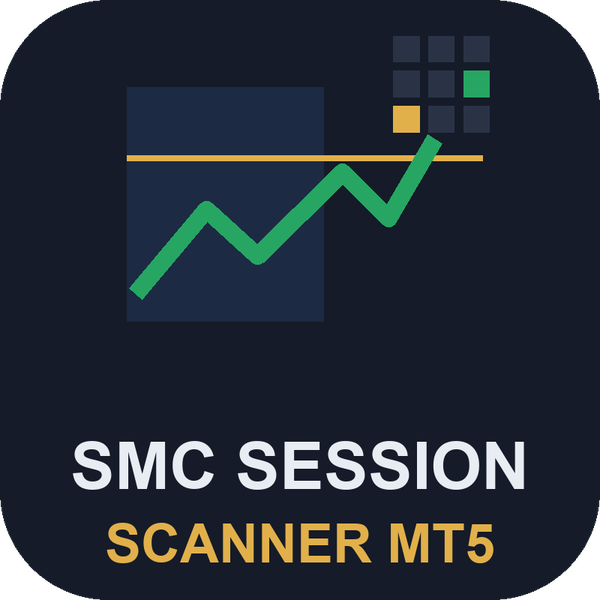
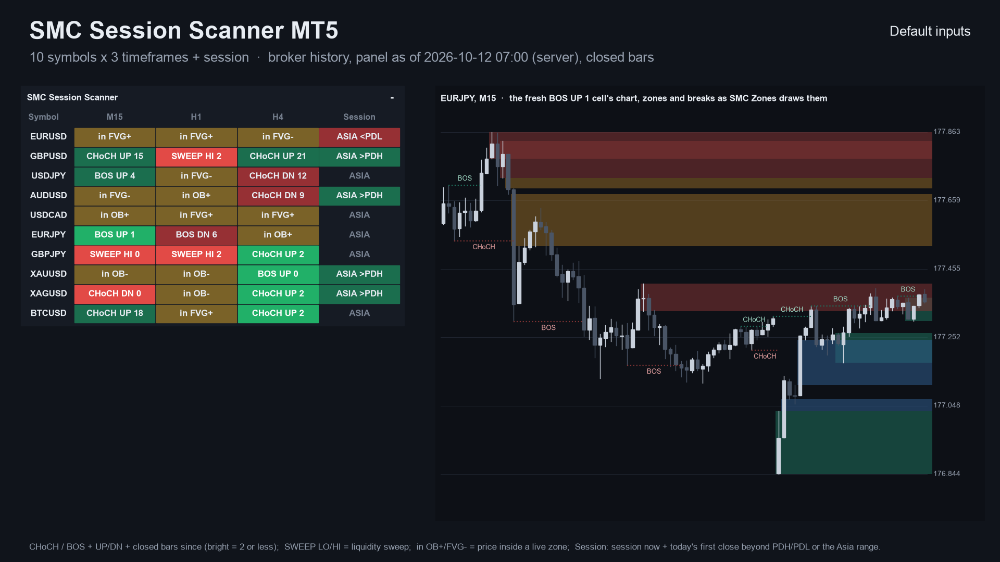
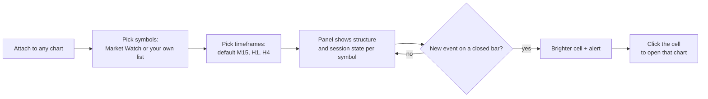
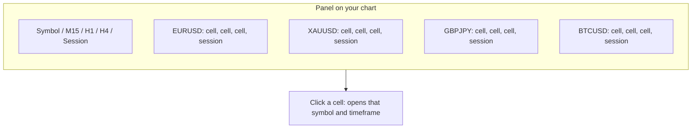
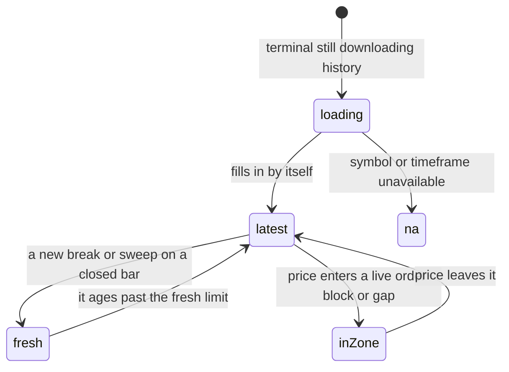
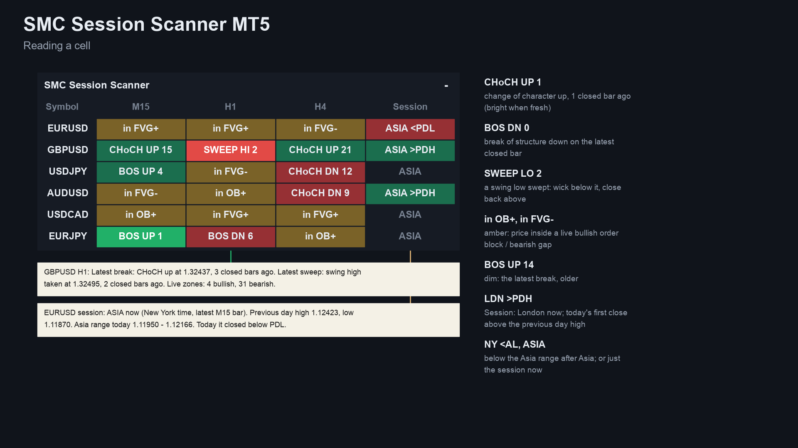
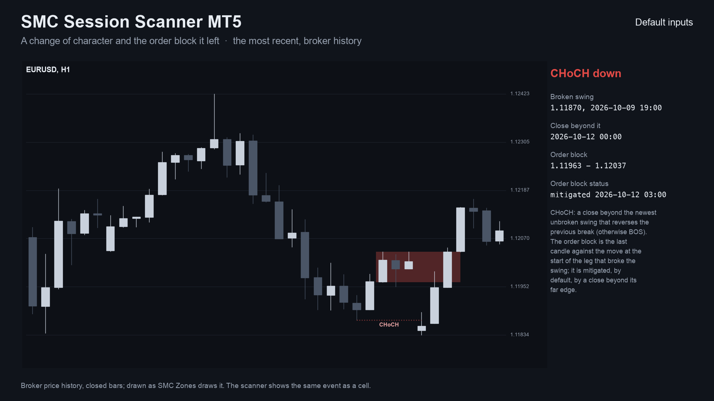
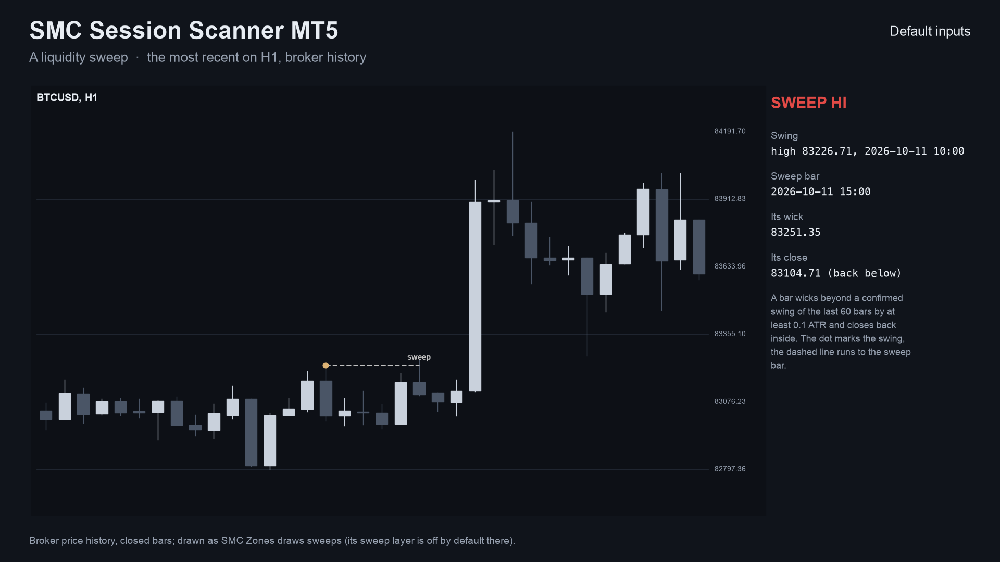
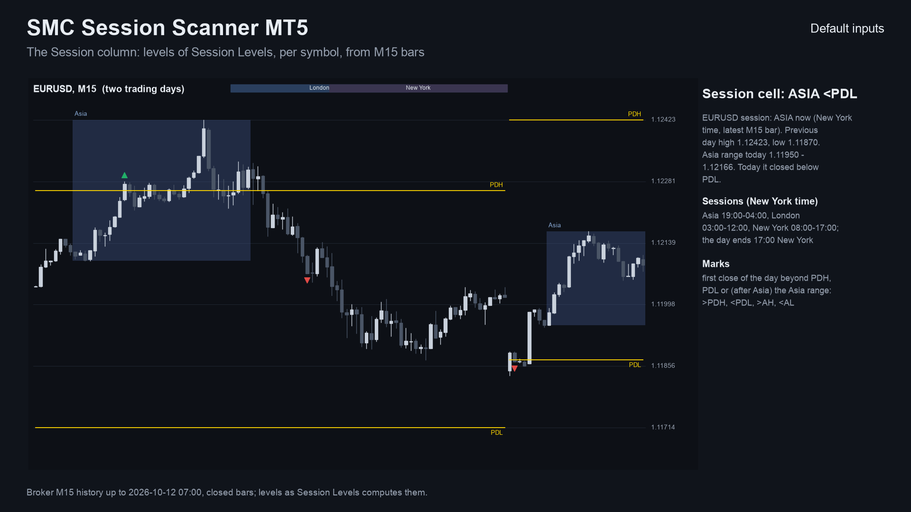
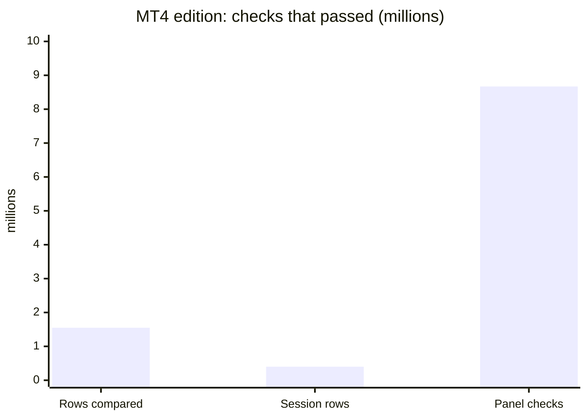

# SMC Session Scanner (MetaTrader 5 and MetaTrader 4)

A scanner indicator that shows, in one panel on your chart, the **smart-money structure and session state of many symbols and
timeframes**: fresh BOS and CHoCH, fresh liquidity sweeps, price inside a live order block or fair value gap, the session now,
and today's first close beyond the previous day high or low or the Asia range. It sends an alert when one appears.

> **This is a showcase repository: documentation and images only. There is no source code here.** The product is sold on
> the MQL5 Market. The two free single-chart indicators it matches have public source:
> [allanninal/smc-zones](https://github.com/allanninal/smc-zones) and [allanninal/session-levels](https://github.com/allanninal/session-levels).

**Website:** [allanninal.dev/mql5 (indicators)](https://www.allanninal.dev/mql5/#indicators) · [MT4 editions](https://www.allanninal.dev/mql5/#mt4) · [allanninal.dev](https://www.allanninal.dev)
· **Contact:** message me on [LinkedIn](https://www.linkedin.com/in/allanninal/).

## Get it on the MQL5 Market

| Product | Platform | Price | Link |
|---|---|---|---|
| **SMC Session Scanner MT5** | MT5 | paid | <https://www.mql5.com/en/market/product/201879> |
| **SMC Session Scanner MT4** | MT4 | paid | <https://www.mql5.com/en/market/product/202425> |
| SMC Zones (single chart, source on GitHub) | MT5 | free | <https://www.mql5.com/en/market/product/201880> |
| SMC Zones MT4 (single chart, source on GitHub) | MT4 | free | <https://www.mql5.com/en/market/product/202375> |
| Session Levels (single chart, source on GitHub) | MT5 | free | <https://www.mql5.com/en/market/product/201881> |
| Session Levels MT4 (single chart, source on GitHub) | MT4 | free | <https://www.mql5.com/en/market/product/202384> |

The scanner is standalone: you do not need to install the free indicators to use it. Details, current price and the Strategy
Tester demo are on the Market pages.

## What it does

- A panel on the chart with **symbols as rows**, a column per **timeframe** (default M15, H1, H4) and a **Session** column.
- **In each timeframe cell:** a fresh `CHoCH UP` / `CHoCH DN` (change of character), `BOS UP` / `BOS DN` (break of structure) or
  `SWEEP HI` / `SWEEP LO` (liquidity sweep) with its age in closed bars; `in OB+`, `in OB-`, `in FVG+`, `in FVG-` when price is inside
  a live order block or fair value gap; otherwise the latest break and how long ago it was, dimmed.
- **In the Session column:** the session now in New York time (Asia, London, New York) and today's first close beyond the
  previous day high (`>PDH`) or low (`<PDL`), or beyond the Asia range (`>AH`, `<AL`).
- **Tooltips** give the levels, the zone prices and how many bars ago each event was.
- **Click a cell** to open that symbol and timeframe.
- **Alerts** for CHoCH, BOS, sweeps, previous-day breaks and Asia-range breaks, each switchable; pop-up, sound, push or
  e-mail. Alerts of the same second come as one message. Nothing is sent while history loads or in the Strategy Tester.
- **Closed bars only.** A cell never changes after its bar has closed. It places no orders.
- The sessions follow your broker's clock automatically (New York close, European or a fixed offset), through daylight saving.

### The panel at a glance

Each row is a symbol; each cell is one symbol on one timeframe, plus one session cell per symbol. You read the whole list in
one look instead of flipping through charts.

### What a timeframe cell can show

| | |
|---|---|
|  |  |
|  |  |

MT4 edition screenshots: [panel on a chart](images/mt4/01-scanner-on-chart.png), [reading a cell](images/mt4/02-reading-a-cell.png).
The screenshots are illustrations built from broker history, not terminal captures.

## Who it is for

Traders who use smart-money structure and the Asia, London and New York sessions on several symbols. If you watch one chart,
the free [SMC Zones](https://www.mql5.com/en/market/product/201880) and
[Session Levels](https://www.mql5.com/en/market/product/201881) draw the same rules on it.

## Why it was built

- The free single-chart indicators cover one chart at a time. A watch list needs a panel.
- Our October 2026 market research found multi-symbol scanners are a recurring want: on the Fiverr and Upwork gigs we scanned,
  9 of 10 dashboard hits were scanner jobs priced at roughly 45 to 145 USD, and on the MQL5 Freelance board 116 of 2,014
  scraped jobs were in the SMC / order block / FVG / liquidity group.
- **Honest scale:** that supply is crowded (about 30 applicants per Freelance job), so this is a niche companion, not a claim of
  mass demand. Its edge is that the panel uses the same stated rules as two free indicators with published tests.
- Design rule carried over from the free indicators: trust. Cells use closed bars only, so what you saw does not change.

## Settings at a glance

Defaults from the listing; none is optimised.

| Setting | Default |
|---|---|
| Symbols | Market Watch, or your own list |
| Timeframes | M15, H1, H4 |
| Structure | swing 3 bars, ATR 14, order block mitigated by a close beyond it, gap by a wick through it, minimum gap 0.2 ATR |
| Sessions (New York time) | Asia 19:00-04:00, London 03:00-12:00, New York 08:00-17:00 |
| Closed bars each cell starts from / fresh limit | 1500 / 2 bars |
| Alerts on by default | CHoCH, sweeps, previous-day breaks (BOS and Asia off) |

## How it was checked (results)

Cell values were compared with the independent Python calculations of the two free indicators.

**MT5 edition (2026-10-16):** 24 structure cells (EURUSD, GBPJPY, XAUUSD, BTCUSD x M15, H1, H4 x two input sets) matched every
break, sweep and zone, including creation and mitigation bars; 8 session cells x 401 M15 rows matched the previous day high and low,
the Asia range and the signal kinds. Total problems: 0. Both builds compile with 0 errors and 0 warnings.

**MT4 edition (2026-10-19, MetaTrader 4 Strategy Tester):**

| Check | Result |
|---|---|
| Test files compared | 126, all pass |
| Rows compared | 1,554,314 |
| Structure files (every break, sweep and zone with its creation and mitigation bar) | 108 |
| Session state rows | 401,808 |
| Live alert flags, each on its own bar | 53,470 |
| Panel fresh counts vs the test's own cells | 8,674,389 checks matched |
| Cells using the forming bar | none; live runs used closed bars only |

These are code checks, not trading results.

## Honest limits

- A scanner shows the state of technical rules. It does not predict the market, and past events are no indication of future
  results. No profit or accuracy claim is made.
- It is an indicator: it places no orders and manages no risk.
- There is no single definition of smart-money concepts; the panel follows the stated rules of the two free indicators.
- It needs the terminal running to alert, and push needs your MetaQuotes ID set up in the terminal.
- The source is not published; this repository documents what the product does and the results of its checks.

## Free vs paid

| | SMC Zones and Session Levels (free) | SMC Session Scanner (paid) |
|---|---|---|
| Scope | one chart each | many symbols x timeframes in one panel |
| Output | zones, BOS / CHoCH lines; session boxes and levels | cells with the structure and session state, plus alerts |
| MT5 | [201880](https://www.mql5.com/en/market/product/201880), [201881](https://www.mql5.com/en/market/product/201881) | [201879](https://www.mql5.com/en/market/product/201879) |
| MT4 | [202375](https://www.mql5.com/en/market/product/202375), [202384](https://www.mql5.com/en/market/product/202384) | [202425](https://www.mql5.com/en/market/product/202425) |
| Source | public on GitHub: [smc-zones](https://github.com/allanninal/smc-zones), [session-levels](https://github.com/allanninal/session-levels) | not published |

---

**Website:** [allanninal.dev/mql5](https://www.allanninal.dev/mql5/#indicators) · [MT4](https://www.allanninal.dev/mql5/#mt4) · [allanninal.dev](https://www.allanninal.dev)
· Questions: message me on [LinkedIn](https://www.linkedin.com/in/allanninal/). All rights reserved, see [LICENSE](LICENSE).
